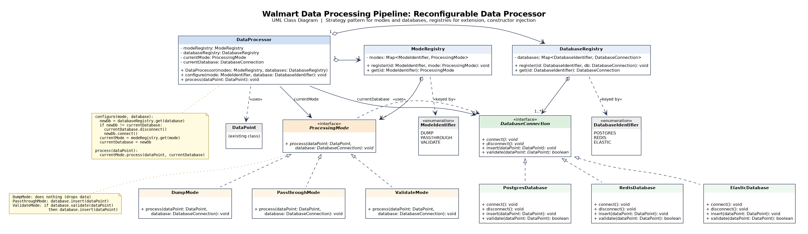
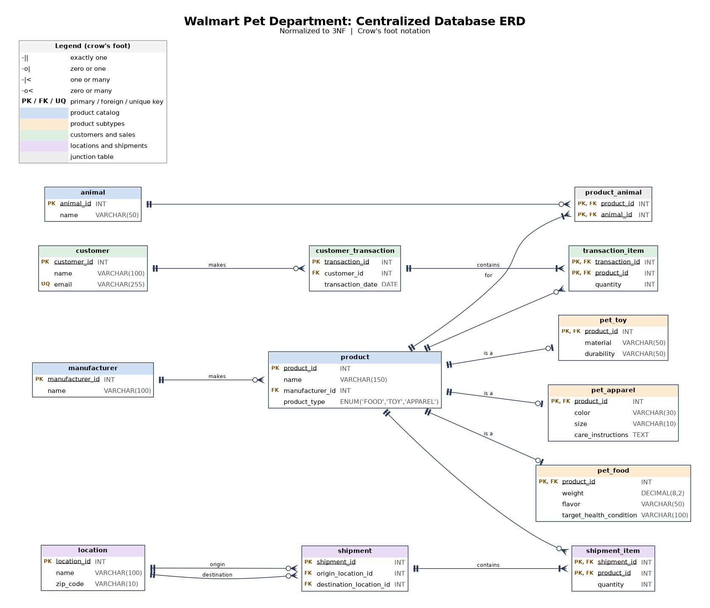

# Walmart Global Tech: Advanced Software Engineering Job Simulation

Completed October 2026. My solutions to the four tasks in the [Walmart Global Tech Advanced Software Engineering job simulation on Forage](https://www.theforage.com/), covering data structures, object-oriented design, database design, and data munging.

Each solution is tested or verified, and each folder explains the design decisions behind it.

| Task | Topic | Language / Tools |
|---|---|---|
| [1. Power-of-two max heap](task1-power-of-two-heap/) | Advanced data structures | Java |
| [2. Reconfigurable data processor](task2-data-processor-uml/) | UML, design patterns, SOLID | UML (Graphviz) |
| [3. Pet department database](task3-pet-department-erd/) | Relational database design | ERD (Graphviz) |
| [4. Shipping data munging](task4-data-munging/) | ETL into SQLite | Python, SQLite |

---

## Task 1: Power-of-two max heap

A max heap in which every parent has 2^x children, with `insert` and `popMax`.

**Design**
- Stored in a primitive `int[]` (no boxing), with parent and child indices computed using bit shifts.
- Sifting uses a "hole" instead of swaps, roughly halving array writes.
- Exponents of 31 and above are handled safely. Java masks shift counts to 5 bits, so `1 << 32 == 1`, which would silently turn the heap into a 1-child heap. Child indices are computed in `long` to avoid overflow.

**Testing:** `PowerOfTwoMaxHeapTest.java` compares the heap with `java.util.PriorityQueue` across exponents from 0 to `Integer.MAX_VALUE`, including duplicates, extreme values, sorted input, and empty-heap errors (575,000+ checks).

**Benchmark** (2 million inserts, then 2 million pops):

| Children | insert | popMax |
|---|---|---|
| 2 | 42 ms | 315 ms |
| 4 | 56 ms | 238 ms |
| 8 | 14 ms | 231 ms |
| 16 | 12 ms | 195 ms |
| 64 | 8 ms | 514 ms |
| 256 | 7 ms | 1447 ms |

More children make the tree shallower, so inserts get faster. But each level of a pop must scan every child, so pops are fastest at around 8 to 16 children.

```bash
cd task1-power-of-two-heap
javac *.java && java PowerOfTwoMaxHeapTest
```

---

## Task 2: Reconfigurable data processor (UML)

A data processor that switches between modes (dump, passthrough, validate) and databases (Postgres, Redis, Elastic) at runtime.



**Design**
- **Strategy pattern, twice:** `ProcessingMode` decides *what* happens to data; `DatabaseConnection` decides *where and how* it is stored. Because they vary independently, 6 small classes give all 9 mode and database combinations.
- **Registries instead of switch statements:** adding a mode or database means one new class and one `register()` call, with no edits to existing code (Open/Closed).
- **Constructor injection** keeps the processor testable with mocks (Dependency Inversion).
- **Connection reuse:** `configure()` only reconnects when the database actually changes.

The PDF includes a page mapping the design to each SOLID principle.

---

## Task 3: Pet department database (ERD)

A normalized (3NF) schema combining products, customers, transactions, locations, and shipments.



**Design**
- **Supertype/subtype products:** shared columns live in `product`; `pet_food`, `pet_toy`, and `pet_apparel` hold type-specific columns. Transactions and shipments reference a single product table, with no NULL-heavy wide table.
- **Junction tables with composite keys** for every many-to-many relationship, which also prevents duplicate line items.
- **Cardinality follows the requirements literally:** a product has *one or more* animals, and a transaction or shipment has *one or more* items.
- `customer_transaction` avoids the SQL reserved word `TRANSACTION`.

---

## Task 4: Shipping data munging

A Python script that combines three spreadsheets with different schemas and loads them into SQLite. One spreadsheet has one row per unit, so rows are grouped by shipment and product to compute quantities, then joined with a second spreadsheet for origin and destination.

**Robustness**
- **Single transaction:** either every row is inserted or none are.
- **Safe to re-run:** the script stops if data already exists, instead of duplicating it. Note that `INSERT OR IGNORE` alone would *not* prevent this, because the `shipment` table has no unique constraint for it to check.
- Columns are read by name (`csv.DictReader`), not position, so reordered columns can't silently corrupt data.
- Parameterized SQL throughout.

**Verified result:** 154 shipment rows and 45 products, with a total quantity of 5,908 that exactly matches the source data.

```bash
# Get the input data and database from Forage's task repo
git clone https://github.com/theforage/forage-walmart-task-4
cp task4-data-munging/populate_database.py forage-walmart-task-4/
cd forage-walmart-task-4 && python3 populate_database.py
```

---

*Completed as part of a Forage job simulation. This is not affiliated with or endorsed by Walmart.*
